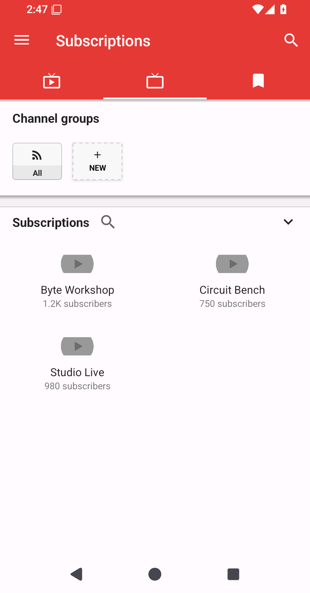
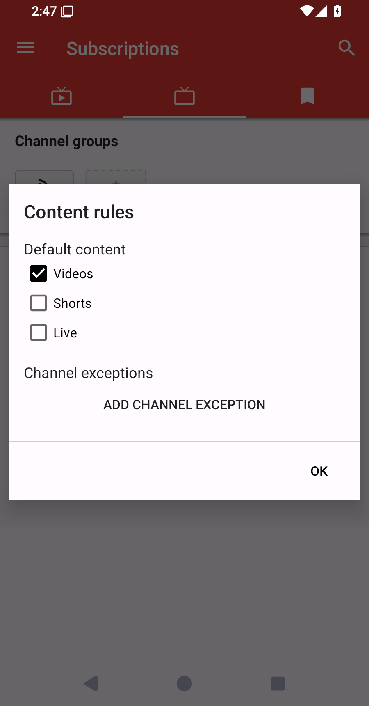
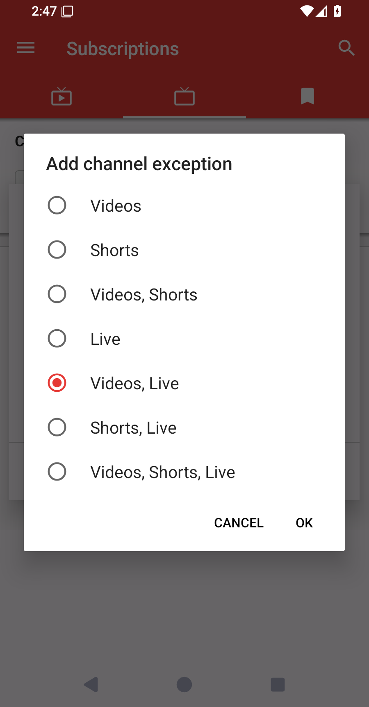
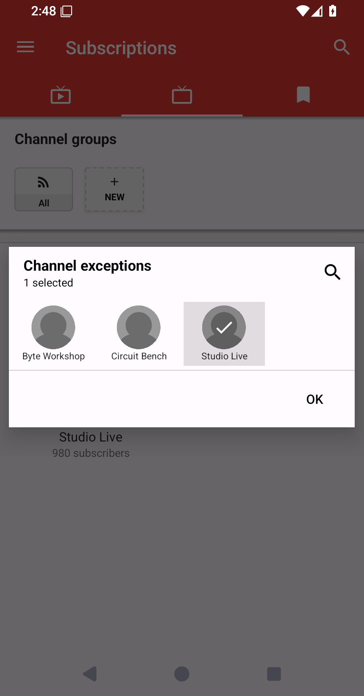
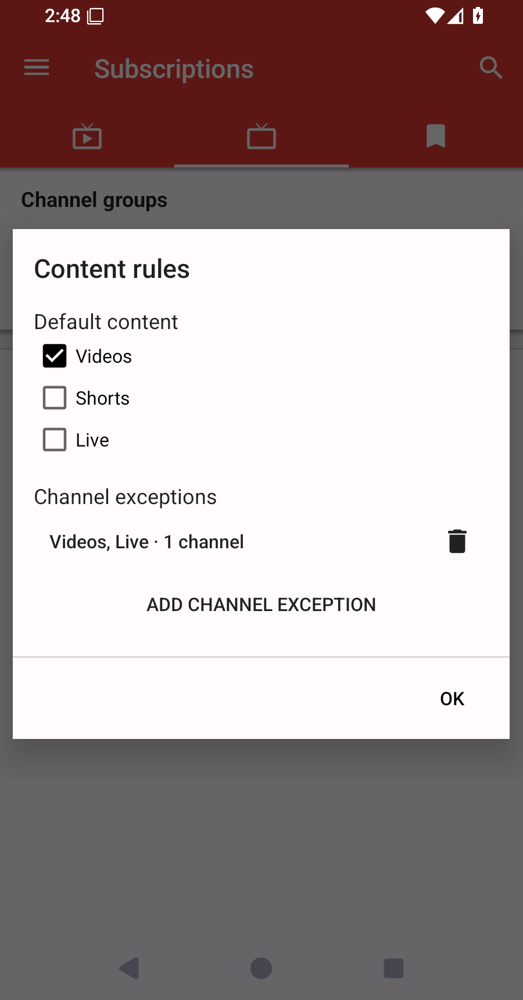
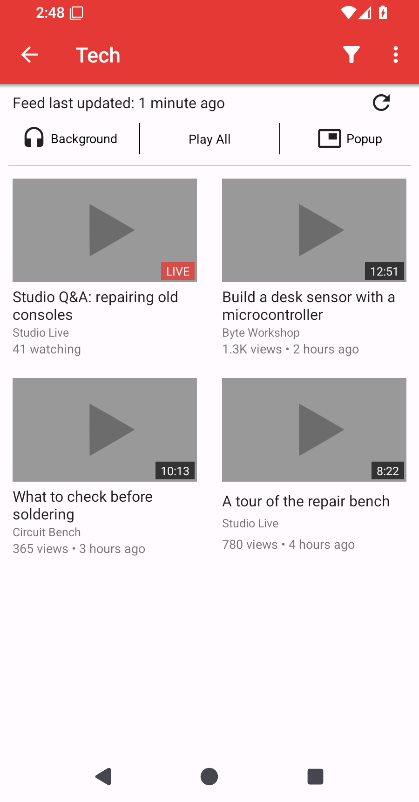

# Filter a subscription group feed

Channel groups make separate feeds from your subscriptions. Use **Configure content** to choose which types a group shows. A channel exception lets one or more channels in the group use a different selection.

This walkthrough makes a **Tech** group that shows regular videos from all its channels and livestreams from **Studio Live**. The screenshots show LeadPipe 5.6.0.24 with sample subscriptions.

## 1. Create a group

Open **Subscriptions** and tap **New** under **Channel groups**. Name the group **Tech**. Tap **Select subscriptions**, pick the channels you want in its feed, and tap **OK**.

To start with a group you already have, press and hold its card.

## 2. Set the group default

Tap **Configure content** in the group editor. Under **Default content**, leave **Videos** checked and turn off **Shorts** and **Live**. Every channel in the group follows this default unless it has an exception.

## 3. Make an exception for one channel

Tap **Add channel exception**, choose **Videos, Live**, and tap **OK**. Select **Studio Live** on the next screen, then tap **OK** again.

An exception sets the full list of types for that channel. Choose **Videos, Live** to keep its regular videos and add livestreams. Choosing **Live** alone shows only its livestreams. A channel can have different rules in another group.

## 4. Save and open the feed

Under **Channel exceptions**, check that the rule shows **Videos, Live** and one channel. Tap **OK**, then **Create** to save the new group. If you opened an existing group, tap **OK** in the group editor to save it.

Tap the **Tech** card to open the feed. In this example it shows regular videos from all three channels and the live Studio Q&A from **Studio Live**. Shorts and livestreams from the other channels are filtered out.

## Change or remove an exception

Press and hold the group card and reopen **Configure content**. Tap the exception to change which channels it applies to. Deselecting a channel restores its group default. Use the delete button next to the exception to restore the default for every channel on that rule. Tap **OK** on each screen to save.

## If an item is missing

- Check that the channel belongs to the group and that the group default or the channel’s exception includes the item’s type.
- Check **Settings → Feed → Fetch channel tabs**. The group can show items the feed has fetched, so make sure the relevant tabs are enabled.
- If Shorts or livestreams are missing or show up as regular videos, turn off **Settings → Advanced → Fetch from dedicated feed when available** and refresh the group. Fast feeds can omit items or leave out the details LeadPipe uses to classify them.
- Clear any feed search and turn on **Show watched items** if you are looking for something you already played.
